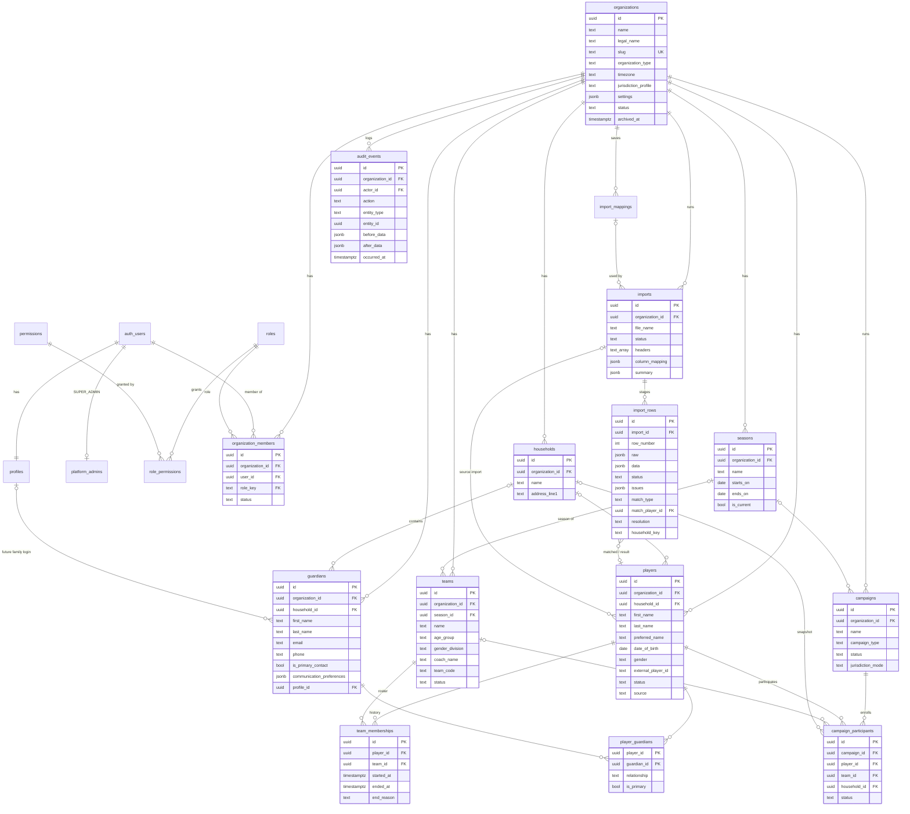

# Raffle Hub — Database Schema

Source of truth: `supabase/migrations/*.sql`. Postgres 15+ (Supabase).

| Migration | Contents |
|---|---|
| `…0100_foundation` | profiles, role/permission catalog, platform admins, organizations, members, authorization helpers, audit log |
| `…0200_master_roster` | seasons, teams, households, guardians, players, player_guardians, team_memberships, duplicate dismissals, `player_directory` view |
| `…0300_roster_functions` | transactional roster RPCs, duplicate finder, dashboard overview |
| `…0400_imports` | import mappings, imports, import rows, `commit_player_import` |
| `…0500_campaign_foundation` | campaigns, campaign_participants (schema only) |

## Conventions

- **UUID primary keys** (`gen_random_uuid()`), except composite keys on pure link tables.
- **`organization_id`** on every organization-owned row.
- **Composite tenant FKs**: children reference `(id, organization_id)` of their
  parent, so cross-tenant references are impossible at the database level.
- **Timestamps**: `created_at`, `updated_at` (trigger-maintained), `created_by`,
  `updated_by` (stamped from `auth.uid()` by trigger).
- **Soft deletion**: `archived_at` (+ `status = 'archived'` where a status exists,
  enforced by a CHECK). Clients have no DELETE grant on roster/fundraising
  tables; `campaigns`/`campaign_participants` block DELETE with a trigger.
- **Uniqueness that ignores archived rows** uses partial unique indexes.
- **RLS is enabled on every table.**

## ERD



## Table classification

| Scope | Tables |
|---|---|
| **Global** (platform catalog) | `roles`, `permissions`, `role_permissions`, `platform_admins` |
| **User-scoped** | `profiles` (one per auth user; visible to self and co-members) |
| **Tenant root** | `organizations` |
| **Organization-scoped** | `organization_members`, `seasons`, `teams`, `households`, `guardians`, `players`, `player_guardians`, `team_memberships`, `player_duplicate_dismissals`, `import_mappings`, `imports`, `import_rows`, `campaigns`, `campaign_participants` |
| **Historical / audit** | `audit_events` (append-only); `team_memberships` (ended rows are history); `imports` + `import_rows` (kept after completion, no delete grant) |

## Tables

### Identity & access

- **`profiles`** — one row per `auth.users` row, created by trigger on signup.
  `last_organization_id` lets the app return users to the org they last used.
- **`roles`** — catalog. `scope` is `platform` (SUPER_ADMIN) or `organization`.
- **`permissions`** — catalog of permission keys (`roster.write`, …) with a
  `scope`; a trigger keeps platform permissions off organization roles.
- **`role_permissions`** — which permissions each organization role grants.
- **`platform_admins`** — users holding SUPER_ADMIN. Service role only.
- **`organization_members`** — user ↔ organization membership with `status`
  (`active`, `suspended`, `removed`).
- **`organization_member_roles`** — one row per role a member holds (multi-role).
  Composite FK to `roles(key, scope)` forbids platform roles; `granted_by`/`granted_at`
  recorded. Deferred triggers keep at least one active ORGANIZATION_ADMIN.
- **`organization_invitations`** — pending access for an email that has no account
  yet: normalized email, roles, `status` (`pending`, `accepted`, `revoked`,
  `expired`), expiry, send count. One pending invitation per org + email.
  Accepted by `accept_my_invitations()` on sign-in (confirmed, exact email only).

### Organization

- **`organizations`** — tenant root: display and legal name, URL slug, type
  (sports club, nonprofit, school, ministry, …), timezone, legal/operator
  address and support contact (needed on future tickets, blueprint §2),
  `jurisdiction_profile`, free-form `settings`, `status`, `platform_config`.
  Slug, status, jurisdiction profile and platform config are **protected**
  (platform admins only, via `platform_update_organization`).

### Master roster

- **`seasons`** — e.g. "2026–27". At most one `is_current` per org (partial unique index).
- **`teams`** — belong to an org and optionally a season. Name is unique per
  org+season among non-archived teams; `team_code` unique per org.
- **`households`** — a family unit; holds many players and many guardians.
- **`guardians`** — adults. Optional household. Generated columns
  `email_normalized` and `phone_digits` power matching and duplicate detection.
  One `is_primary_contact` per household. `profile_id` will link a family login.
- **`players`** — only first and last name are required. Optional household,
  DOB, gender, preferred name, external ID (unique per org), notes. `source`
  records manual / import / self-registration; `source_import_id` links to the import.
- **`player_guardians`** — many-to-many with `relationship` and one `is_primary`
  per player. Supports one player with several guardians and guardians with
  different contact details. Siblings on different teams are simply players in
  the same household with different memberships.
- **`team_memberships`** — the history of team assignments. At most one open
  (`ended_at is null`) row per player. Changing teams closes the open row with
  `end_reason` and opens a new one.
- **`player_duplicate_dismissals`** — pairs an admin marked "not a duplicate".
- **`player_directory`** (view, `security_invoker`) — player + current team +
  season + household + primary guardian, for the directory.

### Imports

- **`import_mappings`** — saved header→field mappings, named by source, with a
  header signature used to auto-suggest a mapping for a new file.
- **`imports`** — one upload. Status `uploaded → mapped → validated → completed`
  (or `cancelled`). Stores headers, chosen mapping and the final summary.
- **`import_rows`** — staged rows: original `raw` cells, mapped+corrected `data`,
  `status` (`ready`, `duplicate`, `error`, `skipped`, `imported`), `issues`,
  duplicate classification (`match_type`, `match_player_id`, `match_reasons`),
  the admin's `resolution`, the planned `household_key`, and the resulting player.

### Campaign foundation (no UI yet)

- **`campaigns`** — any fundraiser type. Status: `DRAFT → READY → ACTIVE →
  CLOSED → DRAWN → ARCHIVED` (plus `READY → DRAFT`, `DRAFT → ARCHIVED`), changed
  only by `transition_campaign`. Ticket price (cents), prefix, goal, family
  target, default allocation, sales window, draw date, support contact, rules
  text/version, operator snapshot, and who/when for activation, close, draw,
  archive. Ticket-critical fields lock at ACTIVE; CLOSED and later are read-only.
- **`campaign_events`** — append-only, hash-chained lifecycle ledger.
- **`ticket_events`**, **`money_events`** — append-only, hash-chained ledgers
  prepared for the ticket and reconciliation phases (see `docs/AUDIT.md` §9).
- **`campaign_participants`** — players enrolled in a campaign with team and
  household snapshots. This is where sellers, inventory and tickets will attach.

### Audit

- **`audit_events`** — append-only: actor, action, entity, before/after, changed
  fields, metadata (incl. `reason`). Written only by triggers / SECURITY DEFINER
  functions. Hash-chained per organization (`chain_pos`, `prev_hash`, `row_hash`).

## Key functions

| Function | Kind | Notes |
|---|---|---|
| `is_platform_admin()`, `is_org_member(org)`, `has_org_permission(org, perm)`, `my_org_permissions(org)` | SECURITY DEFINER, stable | Used by RLS and the app |
| `assert_org_permission(org, perm)` | invoker | Raises `insufficient_privilege` |
| `create_player`, `create_guardian`, `set_player_team`, `bulk_set_player_team`, `add_players_to_household`, `set_primary_guardian`, `set_household_primary_contact` | invoker, transactional | Roster writes |
| `possible_duplicate_players(org)` | invoker | Same name + compatible DOB, minus dismissals |
| `roster_overview(org)` | invoker | Dashboard + Action Needed |
| `commit_player_import(import_id)` | invoker, transactional | Executes reviewed import plan |
| `audit_row_change()` and friends | trigger, SECURITY DEFINER | Writes `audit_events` |
| `has_platform_permission(key)`, `my_org_roles(org)`, `can_assign_role(org, role)` | SECURITY DEFINER, stable | Platform scope, multi-role, grant rule |
| `platform_update_organization(org, changes, reason)` | SECURITY DEFINER | Protected fields; platform admins only |
| `add_organization_member`, `set_member_roles`, `set_member_status`, `revoke_invitation`, `accept_my_invitations` | transactional | Membership changes with reasons |
| `auth_user_id_by_email(email)` | `service_role` only | Exact, case-insensitive; errors on ambiguity |
| `transition_campaign(campaign, to, reason)`, `campaign_readiness(campaign)` | SECURITY DEFINER | Lifecycle + ledger |
| `verify_audit_chain(org)`, `verify_campaign_ledgers(campaign)` | SECURITY DEFINER, stable | Tamper detection |
| `list_households`, `list_org_members`, `list_possible_duplicates`, `team_player_counts`, `platform_organization_summaries` | stable | SQL-side filtering, counts, pagination |

## Local development

```bash
npx supabase start          # local Postgres/Auth/API in Docker
npx supabase db reset       # re-apply all migrations
npx supabase test db        # run pgTAP RLS tests in supabase/tests
npm run seed:dev            # development-only demo data
```
